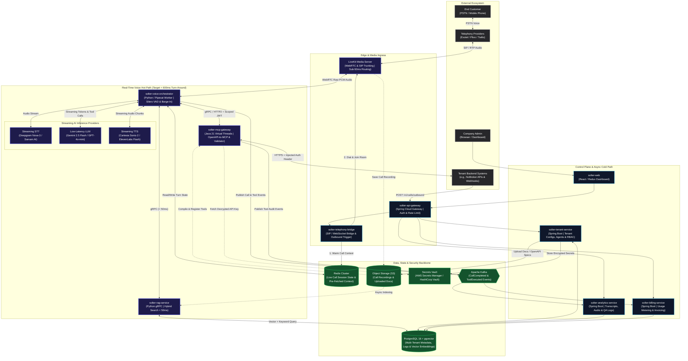
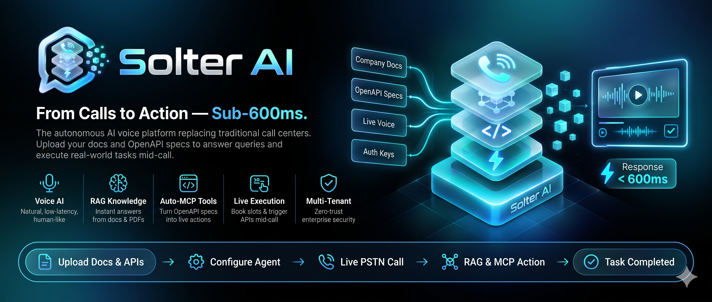

# Solter AI

  <b>The autonomous voice agent that answers questions and takes action on real-time.</b> 
  Voice Agent • Real-Time Action • RAG • MCP

 

---

## System Architecture

---

## Contributing

Repositories are currently private, but I am actively seeking collaborators to help build Solter AI. If you would like to contribute for Solter AI, please reach out to me via [LinkedIn](https://www.linkedin.com/in/dharmarajrathinavel/). 

<!-- 

  
Built with ❤️ by <b><a href="https://dharmaraj-rathinavel.work/">Dharmaraj</a></b>

 -->
